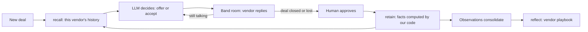

# Counterparty

**An AI procurement buyer that knows when a vendor is bluffing, because it remembers every time they did.**

A vendor says "this is my final price". An AI with no memory has no way to question that. Counterparty recalls that this vendor said the same thing in March, then closed ₹8,000 lower, and keeps talking. It also learns the opposite: which vendors mean it, and which will walk away if pushed.

Counterparty is built on [Hindsight](https://github.com/vectorize-io/hindsight) agent memory, and negotiates live in [Band](https://www.band.ai) rooms.

## Why memory is the product

One "final price" tells you nothing. The pattern only exists across repeated deals, so no single conversation, however long, could reveal it. Whether to believe a vendor has to depend on who the vendor is:

| Vendor (simulated) | What it hides | What the buyer has to learn |
| --- | --- | --- |
| Apex Circuits | Says "final" early, at round 2, but can go much lower | Don't believe the first "final" |
| Nova Components | Moves slowly, says "final" at round 3, drops more at quarter-end | Be patient |
| Bharat PCB | Honest about "final", walks away at round 3 | Stop pushing and take the price |

No fixed strategy wins everywhere. A buyer that always believes "final" overpays Apex and Nova. A buyer that never believes it loses every deal to walk-aways.

## How Hindsight memory is used



| Hindsight feature | How Counterparty uses it | Code |
| --- | --- | --- |
| `retain` | One document per deal, tagged by vendor and timestamped when the deal happened | `HindsightMemory.retain` |
| `recall` | Tag-scoped search of a vendor's history, before every negotiation | `HindsightMemory.recall` |
| `reflect` | A per-vendor playbook, snapshotted as evidence grows, so you can watch its belief change | `HindsightMemory.playbook` |
| Disposition | The bank uses skepticism 5, literalism 4, empathy 1, because claims count for less than outcomes | `HindsightMemory.reset` |
| Missions | `retain_mission` and `reflect_mission` keep memory focused on negotiation behaviour | `engine/memory.py` |
| Observations | Consolidated beliefs are used in live deals. Forget compares raw facts only, because an observation could still carry the forgotten deal | `HindsightMemory.recall` |

## What makes it different

**The Forget button.** Pick any memory, or a whole vendor. The buyer renegotiates the same new deal without it, on the same seeds, and the screen shows the rupee difference. If other memories teach the same lesson, forgetting one changes nothing, and the screen says so.

**A race against its memoryless twin.** The same model, prompt, vendors and deals, with one difference: memory. Results come with a 95% bootstrap interval on the paired per-deal differences.

**Numbers the LLM can't touch.** Vendor prices come from fixed rules and seeds in `engine/simulator.py`. Vendors never use an LLM, so a score is objective and every run is repeatable on the vendor side.

**Memory that can't be poisoned by the counterparty.** Vendor messages are untrusted. Memory stores only facts computed by our code (`DealRecord.to_text`), pressure claims are stored as enums and only marked false when a closing price disproves them, and in a Band room the buyer acts only on a machine-readable tag.

**Human approval.** In a Band room, a deal is remembered only after a person approves it.

## Results

<!-- RESULTS -->
Run `20261106-053341`: 12 simulated deals, 0 LLM errors, 0 fallback decisions.

**Against the strongest fixed no-memory strategy** (offer low, accept the first "final"), replayed on the same deals without an LLM, the Hindsight buyer paid ₹6,031 more per deal (95% interval ₹2,619 to ₹9,505; positive means it paid more). In the last third of deals it paid ₹4,024 more per deal.

Against an LLM buyer with no memory and the same prompt: ₹10,247 saved per deal (95% interval ₹6,738 to ₹13,579). Treat this as the weaker comparison, because that buyer's results depend heavily on prompt wording.

| Vendor | Deals | No memory, avg | With Hindsight, avg | Lost, no memory | Lost, with memory |
| --- | --- | --- | --- | --- | --- |
| Apex Circuits | 4 | ₹105,000 | ₹93,614 | 4 | 1 |
| Bharat PCB | 4 | ₹105,000 | ₹93,876 | 4 | 1 |
| Nova Components | 4 | ₹105,000 | ₹96,767 | 4 | 1 |

Vendors are simulated, so these are not real procurement savings.
<!-- /RESULTS -->

## Run it

Needs Python 3.11 or newer.

```bash
python -m venv .venv
.venv/Scripts/activate            # macOS or Linux: source .venv/bin/activate
pip install -r requirements.txt
cp .env.example .env              # then add GROQ_API_KEY and HINDSIGHT_API_KEY
python scripts/preflight.py       # one real call to each service
python scripts/run_race.py        # records a run and updates this README
uvicorn server:app --port 8765    # dashboard at http://localhost:8765
```

Without keys, the app runs in **rehearsal mode**: a scripted buyer and local memory, clearly labelled on screen, for practising the demo. Rehearsal numbers say nothing about the real agent, and the README ignores them.

For a demo, press **Replay** on a recorded live run. It doesn't depend on rate limits or Wi-Fi, and Forget stays available as long as the keys and the run's memory bank are available.

### Negotiate in a Band room

1. Create two agents in the [Band web app](https://docs.band.ai/quickstart). The vendor's name must contain "vendor".
2. Copy `agent_config.example.yaml` to `agent_config.yaml` and add their credentials.
3. Run `python band_agents.py vendor` and, in a second terminal, `python band_agents.py buyer`.
4. Create a room with both agents, then send `@buyer negotiate apex month 9`. Reply `approve` when the buyer asks.

## Project layout

| Path | What it does |
| --- | --- |
| `engine/simulator.py` | Vendor rules: the objective ground truth |
| `engine/memory.py` | Deal records and Hindsight integration |
| `engine/brains.py` | LLM buyer with function-call error recovery, plus the rehearsal policy |
| `engine/arena.py` | Deals, the race, statistics, Forget |
| `engine/room.py`, `band_agents.py` | Negotiation protocol and Band agents |
| `server.py`, `static/index.html` | Dashboard |
| `scripts/` | Preflight, recording runs, content checks |
| `tests/` | Run with `pytest` |

## Handling function-calling errors

Models sometimes return malformed tool calls. `LLMBrain` recovers the decision from Groq's `failed_generation` or plain text, retries with backoff, clamps invalid prices, and as a last resort uses a conservative fallback so a deal never crashes. Every run reports its error and fallback counts, because a fallback decision isn't the model's own.

## Limits

- Vendors are simulated and their behaviour was designed by us, so savings are simulated too. These are not real procurement savings, and a real vendor is messier.
- A buyer learns a vendor's limit partly by reaching it, so it can lose a deal while learning.
- Vendor behaviour here doesn't change over time. A real vendor could adapt to being challenged.
- Forget measures one rerun scenario, the next deal with that vendor, over a few seeds. It's an estimate, not a full valuation.

© 2026 Thirth Patel. Counterparty, a Matrix product. All rights reserved.
