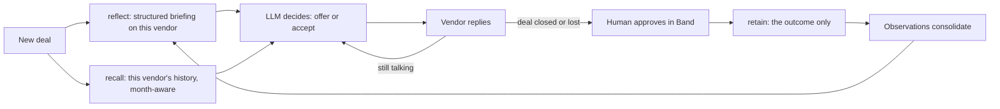

# Counterparty

**An AI procurement buyer that knows when a vendor is bluffing, because it remembers every time they did.**

A vendor says "this is my final price". An AI with no memory has no way to question that. Counterparty recalls that this vendor said the same thing in March, then closed ₹8,000 lower, and keeps talking. It also learns the opposite: which vendors mean it, and which will walk away if pushed.

Counterparty is built on [Hindsight](https://github.com/vectorize-io/hindsight) agent memory, and negotiates live in [Band](https://www.band.ai) rooms.

## Why memory is the product

One "final price" tells you nothing. The pattern only exists across repeated deals, so no single conversation, however long, could reveal it. Whether to believe a vendor has to depend on who the vendor is:

| Vendor (simulated) | What it hides | What the buyer has to learn |
| --- | --- | --- |
| Apex Circuits | Usually says "final" at round 2 or 3, but can go much lower | Don't believe the first "final" |
| Nova Components | Moves slowly, bluffs "final" around round 3, drops more at quarter-end | Be patient, especially at quarter-end |
| Bharat PCB | Honest about "final", walks away around round 3 | Stop pushing and take the price |

These are tendencies, not constants: the bluff and walk-away rounds vary from deal to deal, and a vendor at its patience limit takes a bid within 1% instead of walking. No fixed strategy wins everywhere. A buyer that always believes "final" overpays Apex and Nova, and a buyer that never believes it loses deals to walk-aways.

## How Hindsight memory is used



| Hindsight feature | How Counterparty uses it | Code |
| --- | --- | --- |
| `retain` | One document per deal: the outcome and what the vendor did after each "final", never a lesson. Tagged by vendor and quarter-end, timestamped when the deal happened | `HindsightMemory.retain` |
| `reflect` | Before every deal, a structured briefing (`response_schema`): does this vendor bluff, how many rounds it tolerates, where it walked, lowest close, quarter-end effect. **The buyer negotiates from it** | `HindsightMemory.brief` |
| Disposition | Skepticism 5, literalism 4, empathy 1 shape every briefing, because outcomes count for more than claims | `HindsightMemory.reset` |
| `recall` | Tag-scoped search of a vendor's history, with the month and quarter-end in the query | `HindsightMemory.recall` |
| Observations | Consolidated beliefs feed both recall and the briefing | `HindsightMemory.recall` |
| Bank clone and document delete | Forget really deletes deals from a cloned bank and waits for re-consolidation | `HindsightMemory.forgotten_copy` |
| Missions | `retain_mission` and `reflect_mission` keep memory focused on negotiation behaviour | `engine/memory.py` |

Our code never writes "what to do next time". It records what happened, and Hindsight works out the pattern.

## What makes it different

**A pre-negotiation briefing.** Before each deal, Hindsight reflects on the vendor's history and briefs the buyer. A human buyer can read the same briefing.

**The Forget button.** Pick any memory, or a whole vendor. Hindsight clones the bank, deletes those deals from the clone, and the buyer renegotiates the same new deal with each memory, on the same vendor seeds. The screen shows the rupee difference. If other memories teach the same lesson, forgetting one changes nothing, and the screen says so.

**Honest baselines, fixed in advance.** Every deal is also played by a rule with no memory and no AI, a hand-written learner with perfect memory, and an oracle that knows the vendor's hidden limits. The protocol in [EVALUATION.md](EVALUATION.md) was committed before any run.

**Numbers the LLM can't touch.** Vendor prices come from fixed rules and seeds in `engine/simulator.py`. Vendors never use an LLM, so a score is objective and every run is repeatable on the vendor side.

**Memory that can't be poisoned by the counterparty.** Vendor messages are untrusted. Memory stores only facts computed by our code (`DealRecord.to_text`), pressure claims are stored as enums and only marked false when a closing price disproves them, and in a Band room the buyer acts only on a machine-readable tag.

**Human approval.** In a Band room, a deal is remembered only after a person approves it.

## Results

### Does Hindsight learn the truth about each vendor?

<!-- BELIEFS -->
No live belief studies recorded yet.
<!-- /BELIEFS -->

### Does an LLM negotiator with memory beat a simple rule?

<!-- RESULTS -->
No valid live runs recorded yet under the current protocol.
<!-- /RESULTS -->

## Run it

Needs Python 3.11 or newer.

```bash
python -m venv .venv
.venv/Scripts/activate            # macOS or Linux: source .venv/bin/activate
pip install -r requirements.txt
cp .env.example .env              # then add an LLM key and HINDSIGHT_API_KEY
python scripts/preflight.py       # one real call to each service
python scripts/run_race.py --seed 101   # records a run and rebuilds the results above
uvicorn server:app --port 8765    # dashboard at http://localhost:8765
```

Without keys, the app runs in **rehearsal mode**: a scripted buyer and local memory, clearly labelled on screen, for practising the demo. Rehearsal numbers say nothing about the real agent, and the README ignores them.

Any OpenAI-compatible model works. Set `LLM_PROVIDER` to `groq` (the default), `nvidia` for Nemotron on build.nvidia.com, or `openai` with `LLM_BASE_URL`.

For a demo, press **Replay** on a recorded live run. It doesn't depend on rate limits or Wi-Fi. Forget on a live run needs the keys, and refuses rather than showing rehearsal numbers.

### Negotiate in a Band room

1. Create two agents in the [Band web app](https://docs.band.ai/quickstart). The vendor's name must contain "vendor".
2. Copy `agent_config.example.yaml` to `agent_config.yaml` and add their credentials.
3. Run `python band_agents.py vendor` and, in a second terminal, `python band_agents.py buyer`.
4. Create a room with both agents, then send `@buyer negotiate apex month 9`. Reply `approve` when the buyer asks.

## Project layout

| Path | What it does |
| --- | --- |
| `engine/simulator.py` | Vendor rules: the objective ground truth |
| `engine/memory.py` | Deal records and Hindsight integration |
| `engine/brains.py` | LLM buyer with function-call error recovery, plus the rehearsal policy |
| `engine/arena.py` | Deals, the race, statistics, Forget |
| `engine/room.py`, `band_agents.py` | Negotiation protocol and Band agents |
| `server.py`, `static/index.html` | Dashboard |
| `scripts/` | Preflight, recording runs, content checks |
| `tests/` | Run with `pytest` |

## Handling function-calling errors

Models sometimes return malformed tool calls. `LLMBrain` recovers the decision from Groq's `failed_generation` or plain text, retries with backoff, clamps invalid prices, and as a last resort uses a conservative fallback so a deal never crashes. Every run reports its error and fallback counts, because a fallback decision isn't the model's own.

## Limits

- Vendors are simulated and their behaviour was designed by us, so savings are simulated too. These are not real procurement savings, and a real vendor is messier.
- A buyer learns a vendor's limit partly by reaching it, so it can lose a deal while learning.
- Vendors don't adapt to being challenged, though their tendencies vary from deal to deal. A real vendor could adapt.
- One product, one price, no lead times or payment terms. Real procurement has more to negotiate.
- Forget measures one rerun scenario, the next deal with that vendor, over a few seeds. LLM output varies even at temperature 0, so small differences are noise.
- Earlier runs under protocol v1 had a memory-labelling bug and a prompt that changed between runs. They're kept in `runs/archive-v1` for transparency and aren't used for any claim.

© 2026 Thirth Patel. Counterparty, a Matrix product. All rights reserved.
