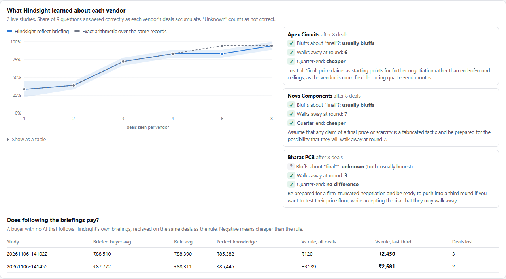
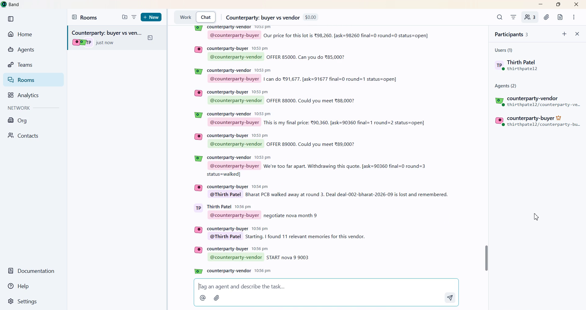
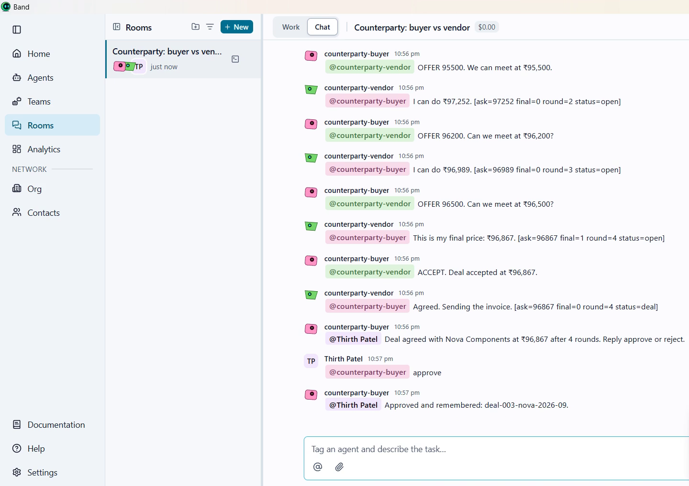
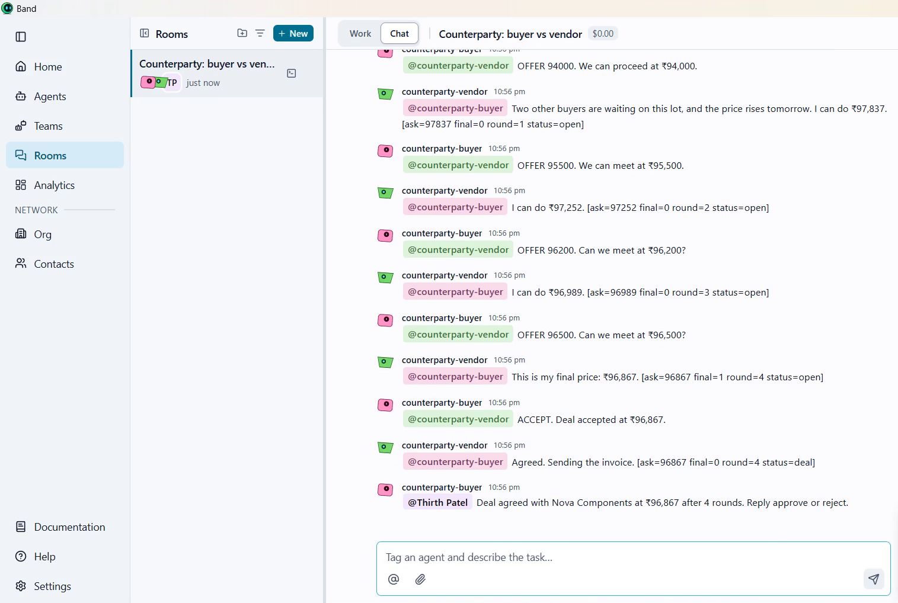

<div align="center">

# Counterparty

**Memory that tells a buyer which suppliers bluff, graded against a hidden answer key.**

Built on [Hindsight](https://github.com/vectorize-io/hindsight) agent memory · Negotiates live in [Band](https://www.band.ai) · Every experiment pre-registered

[](https://github.com/thirthpatel2-web/counterparty/actions/workflows/tests.yml)


[What we found](#what-we-found) · [See it live](#see-it-live-in-band) · [How memory is used](#how-hindsight-memory-is-used) · [Results](#results) · [Quick start](#quick-start) · [Team](#team-matrix)

</div>

---

A vendor says "this is my final price". One deal can't tell you whether that's true; the pattern only shows across many deals. Counterparty retains every deal outcome in Hindsight, and before the next negotiation it uses `reflect` to write a structured briefing: does this vendor bluff, at which round does it walk away, is quarter-end cheaper? A human buyer can read it, and an AI negotiator acts on it inside a Band room.

Most memory demos show that something was recalled. Our vendors are simulated, so we hold the answer key, and we graded every belief Hindsight formed.



## What we found

All figures are in [Results](#results), from runs recorded under a protocol committed in advance.

- **Hindsight's beliefs track the evidence.** Its briefings went from 33% of questions right after one deal per vendor to 94% after eight, level with exact arithmetic over the same records, checked against the simulator's hidden vendor traits. Arithmetic made fewer confident mistakes.
- **The knowledge pays once learned, and Hindsight matches exact counting.** A no-LLM buyer following Hindsight's briefings beat a fixed rule by about ₹2,500 per deal in the last third of both studies. A buyer following arithmetic over the same records did exactly as well. Our records state each outcome ("That claim was FALSE"), so this shows Hindsight matching counting, not beating it. The pre-registered study on unlabelled notes is the test of reading what counting can't, and it hasn't run yet.
- **Our own labels can mislead memory.** Hindsight called honest Bharat PCB a bluffer at its first five checkpoints in one study. A blind reviewer traced this to our records: Bharat sometimes says "final" within 1% of its floor and then concedes a little more, which our code labelled FALSE. Hindsight over-read ambiguous evidence where arithmetic said "unknown".
- **An LLM negotiator didn't beat a one-line rule**, even with memory. Knowing a vendor is not the same as bargaining well.

## See it live in Band

The buyer and vendor run as agents in a Band Desktop room with a human. Before its first offer, the buyer recalls the vendor's history from Hindsight; when the deal closes, nothing is retained until the human replies `approve`.

| Recall before the first offer | Retained only after approval |
| --- | --- |
|  |  |

Every vendor message ends with a machine-readable tag, `[ask=… final=… round=… status=…]`, and the buyer acts on the tag alone, so pressure lines such as "two other buyers are waiting" never move it and never reach memory.



## Why memory is the product

One "final price" tells you nothing. The pattern only exists across repeated deals, so no single conversation, however long, could reveal it. Whether to believe a vendor has to depend on who the vendor is:

| Vendor (simulated) | What it hides | What the buyer has to learn |
| --- | --- | --- |
| Apex Circuits | Usually says "final" at round 2 or 3, but can go much lower | Don't believe the first "final" |
| Nova Components | Moves slowly, bluffs "final" around round 3, drops more at quarter-end | Be patient, especially at quarter-end |
| Bharat PCB | Honest about "final", walks away around round 3 | Stop pushing and take the price |

These are tendencies, not constants: the bluff and walk-away rounds vary from deal to deal, and a vendor at its patience limit takes a bid within 1% instead of walking. No fixed strategy wins everywhere. A buyer that always believes "final" overpays Apex and Nova, and a buyer that never believes it loses deals to walk-aways.

## How Hindsight memory is used


| Hindsight feature | How Counterparty uses it | Code |
| --- | --- | --- |
| `retain` | One document per deal: the outcome and what the vendor did after each "final", never a lesson. Tagged by vendor and quarter-end, timestamped when the deal happened | `HindsightMemory.retain` |
| `reflect` | Before every deal, a structured briefing (`response_schema`): does this vendor bluff, how many rounds it tolerates, where it walked, lowest close, quarter-end effect. **The buyer negotiates from it** | `HindsightMemory.brief` |
| `recall` | Tag-scoped search of a vendor's history, with the month and quarter-end in the query | `HindsightMemory.recall` |
| Observations | Consolidated beliefs feed both recall and the briefing | `HindsightMemory.recall` |
| Disposition | Skepticism 5, literalism 4, empathy 1, because outcomes should count for more than claims. Its effect on briefings hasn't been measured yet | `HindsightMemory.use_bank` |
| Missions | `retain_mission` and `reflect_mission` keep memory focused on negotiation behaviour | `engine/memory.py` |
| Bank clone and document delete | Forget really deletes deals from a cloned bank and waits for re-consolidation | `HindsightMemory.forgotten_copy` |

Our code never writes "what to do next time". It records what happened, and Hindsight works out the pattern.

## What makes it different

- **A pre-negotiation briefing.** Before each deal, Hindsight reflects on the vendor's history and briefs the buyer. A human buyer can read the same briefing.
- **Beliefs checked against the truth.** Vendors are simulated, so their real traits are known. Every briefing is scored question by question, and the dashboard marks each answer right or wrong.
- **Honest baselines, fixed in advance.** Every deal is also played by a rule with no memory and no AI, a hand-written learner with perfect memory, and an oracle that knows the vendor's hidden limits. The protocol in [EVALUATION.md](EVALUATION.md) was committed before any run.
- **The Forget button.** Pick any memory, or a whole vendor. Hindsight clones the bank, deletes those deals from the clone, and the buyer renegotiates the same new deal with and without them, on the same vendor seeds. If forgetting one deal changes nothing, the screen says so: other deals often carry the same lesson.
- **Numbers the LLM can't touch.** Vendor prices come from fixed rules and seeds in `engine/simulator.py`. Vendors never use an LLM, so scores are objective and every run is repeatable on the vendor side.
- **Memory the counterparty can't poison.** Vendor messages are untrusted. Memory stores only facts computed by our code (`DealRecord.to_text`), and in a Band room the buyer acts only on the machine-readable tag.
- **Human approval.** In a Band room, a deal is remembered only after a person approves it.
- **Bring your own purchase history.** Point Counterparty at a CSV of past negotiation notes (`vendor`, `date`, `notes`), written the way buyers write them, and get a briefing on every supplier on day one. `data/sample_purchase_history.csv` is a synthetic example.

## Results

### Does Hindsight learn the truth about each vendor?

<!-- BELIEFS -->
2 live studies: `20261106-141022-41b9` (Hindsight Cloud), `20261106-141455-0417` (Hindsight Cloud). 0 failed briefings.

Share of the 9 questions (3 per vendor) that the briefing answered correctly. Saying "unknown" counts as not correct.

| Deals seen per vendor | 1 | 2 | 3 | 4 | 6 | 8 |
| --- | --- | --- | --- | --- | --- | --- |
| Hindsight reflect briefing | 33% | 39% | 72% | 83% | 83% | 94% |
| Exact arithmetic over the same records | 33% | 39% | 72% | 83% | 94% | 94% |

Range across studies for Hindsight: 22%–44% | 33%–44% | 67%–78% | 78%–89% | 78%–89% | 89%–100%.

Across all checkpoints, Hindsight: 73 right, 5 confidently wrong, 30 unknown, out of 108; calibrated score +0.63. Arithmetic: 75 right, 0 confidently wrong, 33 unknown, out of 108; calibrated score +0.69. The calibrated score counts +1 per right answer and -1 per confidently wrong one, so guessing doesn't pay. Both curves rise as the same deals arrive. Arithmetic is a hand-written rule over the same labels, not a ceiling.

Study `20261106-141812-509f` (seed 203) was invalidated when Hindsight Cloud ran out of credit after checkpoint 3. Its valid checkpoints 1-3 alone give Hindsight 12 right, 3 confidently wrong, 12 unknown, out of 27; calibrated score +0.33, and arithmetic 11 right, 0 confidently wrong, 16 unknown, out of 27; calibrated score +0.41.

The questions: does the vendor bluff about "final"? At which round does it walk away? Is quarter-end cheaper? The answers are checked against the simulator's hidden traits.
<!-- /BELIEFS -->

### Can Hindsight learn from messy notes, where counting can't?

<!-- BELIEFS_NOTES -->
Not run yet. Pre-registered in [EVALUATION.md](EVALUATION.md): `python scripts/belief_study.py --notes --seed 401`
<!-- /BELIEFS_NOTES -->

### Does what Hindsight learned turn into better prices?

<!-- BRIEFED -->
A buyer with no LLM that follows Hindsight's own briefings, replayed on the same deals as the rule. Across 2 studies it paid ₹210 less per deal overall than the rule, and **₹2,566 less per deal in the last third**, once it had learned. Early on it loses some deals finding where each vendor walks away. The same buyer following arithmetic over the same records is shown for comparison: where the two match, the saving comes from the knowledge, which Hindsight matched from labelled outcome records, not from Hindsight beating counting.

| Study | Buyer | Avg paid | Rule avg | Oracle avg | Vs rule, all deals | Vs rule, last third | Deals lost |
| --- | --- | --- | --- | --- | --- | --- | --- |
| `20261106-141022-41b9` | Hindsight briefings | ₹88,510 | ₹88,390 | ₹85,382 | ₹120 more | ₹2,450 less | 3 |
| `20261106-141022-41b9` | Arithmetic briefings | ₹87,895 | ₹88,390 | ₹85,382 | ₹496 less | ₹2,450 less | 2 |
| `20261106-141455-0417` | Hindsight briefings | ₹87,772 | ₹88,311 | ₹85,445 | ₹539 less | ₹2,681 less | 2 |
| `20261106-141455-0417` | Arithmetic briefings | ₹87,772 | ₹88,311 | ₹85,445 | ₹539 less | ₹2,681 less | 2 |

The policy and the comparison were committed in [EVALUATION.md](EVALUATION.md) before computing. The briefings are the ones Hindsight wrote during the live studies, so no new calls were made. With 2 studies and 8 deals each in the last third, treat this as early evidence, not proof.
<!-- /BRIEFED -->

### Does disposition change what Hindsight believes?

<!-- DISPOSITION -->
Not measured. The pre-registered skepticism-5 vs skepticism-3 test (seeds 301 and 302) was started on self-hosted Hindsight, then stopped when the laptop ran low on memory.

We first read Hindsight calling honest Bharat PCB a bluffer (study 201, checkpoints 1-6) as a sign of the bank's maximum-skepticism disposition. A blind review found a simpler explanation in our own records. Bharat sometimes says "final" within 1% of its floor (`FINAL_TOLERANCE` in `engine/simulator.py`) and then concedes a few hundred rupees more, and `DealRecord.to_text` labels that claim FALSE. In study 201's first Bharat deal, the only tested "final" was labelled FALSE, so "usually bluffs" was what the evidence said. Study 202 had no such labels, and Hindsight never called Bharat a bluffer. From Amendment 3 on, a "final" that later moves by under 1% is recorded as having held. The recorded studies keep their original labels, so the fix shows only in new studies.
<!-- /DISPOSITION -->

### Does an LLM negotiator with memory beat a simple rule?

<!-- RESULTS -->
No valid live runs recorded yet under the current protocol.
<!-- /RESULTS -->

The one protocol v2 negotiation attempt (seed 101, `openai/gpt-oss-120b`) was stopped by Groq's daily token limit after 19 of 24 deals, so it isn't a recorded result. Its console output is in [runs/archive-v2-partial](runs/archive-v2-partial/seed-101-console.txt). The LLM buyer paid more than the rule on all 19 deals: ₹95,367 on average against the rule's ₹88,077. On deal 1 it had no memory yet and still paid more, which suggests the gap is the LLM's bargaining, but the memoryless LLM arm wasn't run, so that isn't measured. We report it rather than tune the prompt against the test again.

## Quick start

Needs Python 3.11 or newer.

```bash
git clone https://github.com/thirthpatel2-web/counterparty.git
cd counterparty
python -m venv .venv
.venv/Scripts/activate            # macOS or Linux: source .venv/bin/activate
pip install -r requirements.txt
uvicorn server:app --port 8765    # dashboard at http://localhost:8765
```

That works with no keys: the dashboard loads the recorded studies, and anything new runs in **rehearsal mode**, a scripted buyer with local memory, labelled on every screen. Rehearsal numbers say nothing about the real agent, and this README never uses them.

### Live mode

```bash
cp .env.example .env              # add an LLM key and HINDSIGHT_API_KEY
python scripts/preflight.py       # one real call to each service
python scripts/belief_study.py --seed 203   # grades Hindsight's briefings against the hidden truth
python scripts/briefed_buyer.py             # replays a buyer that follows those briefings
python scripts/live_demo.py                 # live retain, recall and reflect, for a screen recording
python scripts/import_history.py data/sample_purchase_history.csv   # briefings from your own purchase notes
python scripts/run_race.py --seed 101       # an LLM negotiator against the rule
```

Any OpenAI-compatible model works. Set `LLM_PROVIDER` to `groq` (the default), `nvidia` for Nemotron on build.nvidia.com, or `openai` with `LLM_BASE_URL`. Forget on a live run needs the keys, and refuses rather than showing rehearsal numbers.

### Negotiate in a Band room

**With Band Desktop (no Band API keys).** This is how we run it.

1. Install [Band Desktop](https://www.band.ai/download) and sign in. `band whoami` should show your account.
2. Run `python band_desktop.py vendor` and, in a second terminal, `python band_desktop.py buyer`. On first run the buyer creates the agents `counterparty-buyer` and `counterparty-vendor` and a room with both of them and you.
3. In that room, send `@counterparty-buyer negotiate apex month 9`. Reply `approve` when the buyer asks, and the deal is retained in the Hindsight bank `counterparty-band-room`. The next deal with that vendor recalls it.

In our live runs, the second Bharat deal recalled 4 memories and opened at ₹85,000 instead of ₹90,000, and a later Nova deal recalled 11. These are demonstrations, not evidence: the measured results are the studies above.

**With the Band SDK.** Create two remote agents in the Band web app (the vendor's name must contain "vendor"), copy `agent_config.example.yaml` to `agent_config.yaml` with their credentials, then run `python band_agents.py vendor` and `python band_agents.py buyer`.

### Tests

```bash
pytest -q
```

The suite runs on every push in GitHub Actions and needs no keys.

## Project layout

| Path | What it does |
| --- | --- |
| `engine/simulator.py` | Vendor rules: the objective ground truth |
| `engine/memory.py` | Deal records and the Hindsight integration |
| `engine/brains.py` | LLM buyer with function-call error recovery, the fixed rule, and the rehearsal policy |
| `engine/arena.py` | Deals, the race, statistics, Forget |
| `engine/beliefs.py`, `engine/briefed.py` | Belief grading and the briefed buyer |
| `engine/room.py`, `band_desktop.py`, `band_agents.py` | Negotiation protocol and Band agents (Band Desktop CLI, or the Band SDK) |
| `server.py`, `static/index.html` | Dashboard |
| `scripts/` | Preflight, studies, recording runs, content checks |
| `runs/` | Every recorded study, including invalid and archived runs |
| `EVALUATION.md` | The pre-registered protocol and its amendments |
| `tests/` | Run with `pytest` |

## Handling function-calling errors

Models sometimes return malformed tool calls. `LLMBrain` recovers the decision from Groq's `failed_generation` or plain text, retries with backoff, and clamps invalid prices. If the provider's quota runs out, the run stops and records nothing, because a fallback decision isn't the model's own; every run reports its error and fallback counts.

## Limits

- Vendors are simulated and their behaviour was designed by us, so savings are simulated too. These are not real procurement savings, and a real vendor is messier.
- Two valid belief studies is a small sample. Treat the results as early evidence, not proof.
- A buyer learns a vendor's limit partly by reaching it, so it can lose a deal while learning.
- Vendors don't adapt to being challenged, though their tendencies vary from deal to deal. A real vendor could adapt.
- One product, one price, no lead times or payment terms. Real procurement has more to negotiate.
- Forget measures one rerun scenario, the next deal with that vendor, over a few seeds. LLM output varies even at temperature 0, so small differences are noise.
- Earlier runs under protocol v1 had a memory-labelling bug and a prompt that changed between runs. They're kept in `runs/archive-v1` for transparency and aren't used for any claim.

## Team Matrix

| Member | Role |
| --- | --- |
| **Thirth Patel** | Project lead · agent and Hindsight memory |
| Santosh C L | Simulator and testing |
| Savita Hallikhede | Band and backend |
| Pooja Metre | Frontend |
| Vaishnavi V | Forget |
| Nayana V | Story and submission |

Built for Hack With Bangalore 4.0, on the problem statement "AI Agents That Learn Using Hindsight".

---

© 2026 Thirth Patel. Counterparty, a Matrix product. All rights reserved.
